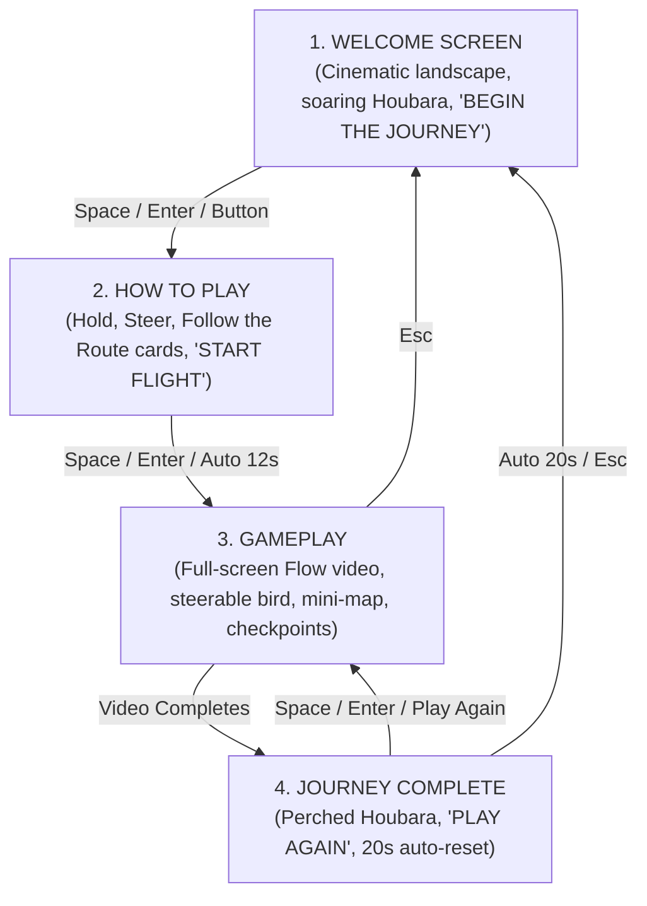

# Houbara Migration — Exhibition Interactive Experience

An exhibition-grade browser application recreating the four-screen cinematic visual reference for the **Houbara Migration** experience. Built for large 16:9 landscape displays.

---

## Visual Design System

Matched to the exhibition reference:
- **Palette**: Dark forest-green (`#0D1E18`, `rgba(13, 30, 24, 0.82)`) and charcoal panels with warm ivory text (`#F5F0E6`) and subtle brushed gold accents (`#C8A96B`).
- **Panels**: Translucent rounded glass containers with thin gold borders and backdrop-blur.
- **Topographic Details**: Subtle elevation contour line watermarks and thin outer screen frame.
- **Typography**: Classic cinematic serif headings (*Cinzel*) paired with clean uppercase sans-serif sub-headers and body (*Montserrat*).

---

## The Four Screens



1. **Welcome Screen** (Top-Left Reference):
   - Soaring Houbara bustard with wings spread on the left.
   - Ornate emblem, serif title `HOUBARA MIGRATION`, subtitle `A JOURNEY ACROSS VAST LANDSCAPES`.
   - Translucent gold pill button `BEGIN THE JOURNEY >`.
   - Serves as the idle attract screen when not in use.

2. **How to Play Screen** (Top-Right Reference):
   - Three clean translucent cards:
     - **HOLD**: "Hold the controllers in each hand."
     - **STEER**: "Move your hands to steer the Houbara."
     - **FOLLOW THE ROUTE**: "Stay on the migration path across vast landscapes."
   - Keyboard & gamepad steering guidance.
   - Primary `START FLIGHT >` button with auto-advance countdown.

3. **Gameplay Screen** (Bottom-Left Reference):
   - Fullscreen pre-rendered landscape video running smoothly behind all UI.
   - Separate transparent Houbara bird layered at **50% width and 61% height**.
   - Smooth horizontal steering with gentle banking rotation (tilt).
   - In-world 3D perspective dotted route with glowing waypoint nodes.
   - Top-center objective banner: `GUIDE THE HOUBARA` (fades after 6s).
   - Bottom-left steering hint: `[ < ] [ > ] STEER LEFT OR RIGHT` (fades after 5s).
   - Bottom-right combined **Migration Map and Information Panel**:
     - Mini-map with terrain, dotted route, moving bird marker, and compass rose.
     - `CONCEPT ROUTE` header with 4-stage progress indicators (`● ─── ○ ─── ○ ─── ○`).
     - Feather icon + rotating conservation facts.
   - 3 Configurable checkpoints with `CHECKPOINT REACHED` notifications.

4. **Journey Complete Screen** (Bottom-Right Reference):
   - Sunset mountain landscape with Houbara perched majestically on rocks.
   - `JOURNEY COMPLETE` heading with thank-you conservation text.
   - `PLAY AGAIN >` button and automatic 20-second return countdown.

---

## Controls

### Keyboard
| Key | Action |
|---|---|
| **← / →** or **A / D** | Steer the bird left and right |
| **Space** or **Enter** | Activate primary button / start flight |
| **Escape** | Return to Welcome screen |
| **D** | Toggle Operator Dev Panel |
| **N** | Skip to next scene (development shortcut) |
| **F** | Toggle full-screen mode |

### Gamepad (Browser Gamepad API)
| Input | Action |
|---|---|
| **Left Stick X-Axis** | Steer the bird (smooth analog input) |
| **D-Pad Left / Right** | Steer the bird (digital fallback) |
| **Button 0 (A / ✕)** | Confirm / Start Flight / Play Again |
| **Button 1 (B / ○)** | Cancel / Return to Welcome |

---

## Asset Directory Structure

All assets are organized into dedicated folders in `public/assets/`:

```
public/assets/
├── backgrounds/
│   ├── welcome-bg.jpg            # Welcome screen landscape background
│   ├── instructions-bg.jpg       # How to Play background
│   └── completion-bg.jpg         # Journey complete sunset background
├── bird/
│   ├── bird.png                  # Transparent PNG rear-view flying bird
│   └── bird.glb                  # (Future) Animated 3D GLB model
└── video/
    ├── scene1-valley.mp4         # Breeding Grounds video clip
    ├── scene2-mountains.mp4      # Mountain Crossing video clip
    ├── scene3-desert.mp4         # Desert Passage video clip
    └── scene4-snow.mp4           # Wintering Grounds video clip
```

---

## How to Customize & Configure

All parameters are centralized in:

📁 **[`src/config/gameConfig.js`](src/config/gameConfig.js)**

### 1. Replacing the Background Video
Update `assets.video.scenes` or provide your master Google Flow video file in `assets.video.fullJourney`:
```javascript
video: {
  fullJourney: '/assets/video/your_flow_video.mp4',
  scenes: [
    { id: 'valley', src: '/assets/video/your_clip_1.mp4' },
    ...
  ]
}
```

### 2. Replacing the Bird
- **Transparent PNG**: Replace `public/assets/bird/bird.png`.
- **Animated 3D Model**: Place your `.glb` model at `public/assets/bird/bird.glb`. Inside [`src/components/Bird.jsx`](src/components/Bird.jsx), swap the `` element for a Three.js / React Three Fiber `<Canvas>` loading the GLB.

### 3. Tuning Bird Physics & Bounds
```javascript
bird: {
  startX: 0.50,         // 50% horizontal center
  startY: 0.61,         // 61% vertical center
  speed: 11,            // horizontal movement speed
  maxTilt: 18,          // banking rotation in degrees
  tiltSmoothing: 0.12,  // banking responsiveness
  returnSmoothing: 0.08,// recovery to neutral 0°
  scale: 1.0,           // scale multiplier
}
```

### 4. Editing Checkpoints, Stages & Facts
```javascript
// 3 In-game checkpoints
checkpoints: [
  {
    timeProgress: 0.28,
    name: 'Steppe Outpost',
    fact: 'Houbara bustards migrate over 2,000 km...',
    message: 'CHECKPOINT REACHED',
  },
  ...
],

// Conservation facts rotating in the bottom-right panel
facts: [
  'Some Houbara populations migrate between seasonal habitats.',
  ...
]
```

---

## Hardware & Motion Controller Integration Notes

The input handling is strictly decoupled from the gameplay logic:
- [`src/hooks/useKeyboard.js`](src/hooks/useKeyboard.js)
- [`src/hooks/useGamepad.js`](src/hooks/useGamepad.js)
- [`src/hooks/useInput.js`](src/hooks/useInput.js) (merges inputs into `{ horizontal, confirm, cancel }`)

### What is needed for final motion controllers:
1. **Controller Hardware Model & Connection Type**: Whether the final hardware connects via:
   - WebHID / WebUSB API (for custom USB sensors)
   - Web Bluetooth API (for wireless IMU controllers)
   - WebSocket / OSC bridge (for external sensor software like Open Sound Control, TouchDesigner, or Arduino)
2. **Axis Mapping**: Map the 2-hand controller's differential tilt or roll angle to the normalised `-1.0` to `+1.0` horizontal steering output.
3. Adding a new controller requires only adding a `useMotionController.js` hook and importing it into `useInput.js`.

---

## Launching & Running Offline

### Local Development
```bash
npm install
npm run dev
```
Open **http://localhost:3000** in your browser.

### Production Build (For Exhibition PC)
```bash
npm run build
npx serve dist -l 3000
```
This produces an optimised, standalone build in `dist/` that runs **100% offline** with zero external network requests.

## Notes
- Fonts (Cinzel, Montserrat) are bundled via npm (@fontsource), so the app runs fully offline.
- Menu backgrounds are stills of your own videos; menu screens loop the scene clips.
- Controller/route illustrations are SVG placeholders in src/components/InstructionIllustrations.jsx.
- Dev URLs: ?screen=WELCOME|INSTRUCTIONS|PLAYING|COMPLETION, and &static to disable fades.

- Migration Journey map: edit nodes/labels in gameConfig.js (journeyPanel); change region framing in src/utils/mapProjection.js then run npm run build-map to regenerate public/assets/map/region-map.svg (data from Natural Earth, bundled locally).
